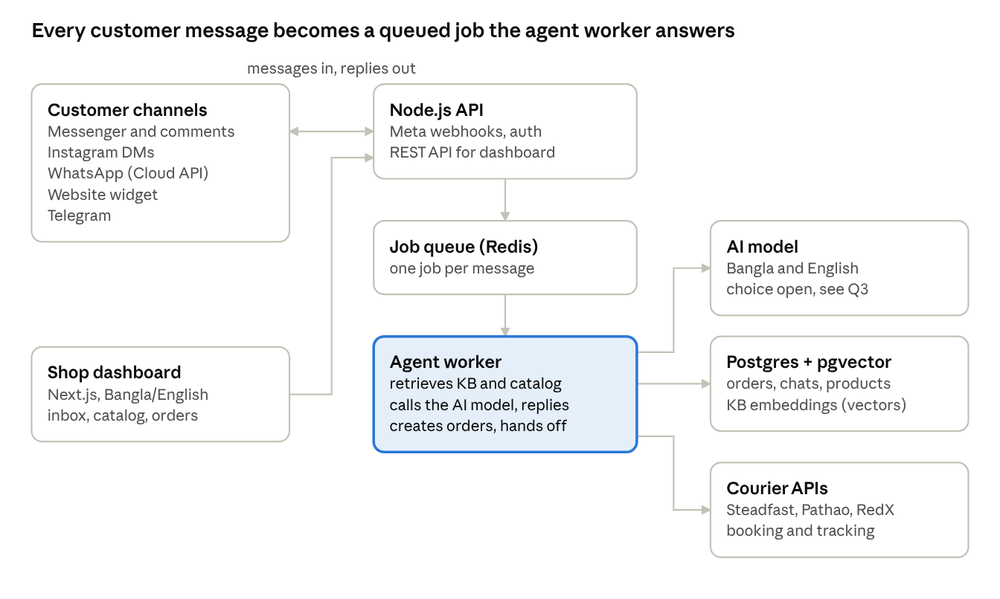

# Agently product specification

Oct 21, 2026 · @Sharif

## Summary

Agently is a multi-tenant SaaS that lets a Bangladeshi f-commerce shop create an AI sales and support agent, train it on its own products and content, and run it on Facebook Messenger first, then WhatsApp, Instagram, a website widget and Telegram, all from one dashboard.

**Target customer:** small and mid-size Facebook-first shops in Bangladesh, with the platform sized for thousands of connected pages. Customers write in Bangla, English and Banglish (Bangla in Latin letters), and most orders are cash on delivery.

**The biggest gap in the brief:** it describes a clickable prototype ("realistic mock data, local state, persistence across reloads"), but the real goal is a production bot that answers real customers, takes real orders and tracks courier deliveries. This spec keeps the brief's screens and design, and adds the backend, integrations and data model a production product needs. Decided: we build the real product, starting with Phase 1.

**Agreed so far:** Next.js (React) front end and Node.js back end, both TypeScript. WhatsApp is 1-to-1 business chat only, no groups. The AI model is still open.

## Scope

The proposed MVP is one channel done properly: Facebook Messenger (plus page comments) answering from a shop's catalog and knowledge base, taking orders, and handing off to a human. Everything else in the brief is phased in after that works with real shops.

| Phase | What ships | Why here |
| --- | --- | --- |
| 0. Clickable prototype (optional) | The brief as written: all screens on mock data, for demos and design sign-off | Dropped: we build the real product directly |
| 1. MVP | Auth, onboarding, Messenger connect, knowledge base (files, text, Q&A, website crawl), product catalog with color × size stock, AI replies in Bangla and English, order capture, conversations inbox with human handoff, leads, Bangla/English UI | Messenger is where the shops and their customers already are |
| 2. Commerce depth | Order status flow, courier booking and tracking (Steadfast, Pathao, RedX), customer order-tracking via chat, Instagram DMs, website widget, analytics | Needs a stable order model first |
| 3. More channels | WhatsApp Business (Cloud API), Telegram, Google Sheets sync, Slack alerts | WhatsApp needs Meta business verification and per-conversation fees |
| 4. Scale and billing | Subscription plans, usage limits, agencies managing many shops (Clients), multiple agents per shop | Once paying shops exist |

**Out of scope for now:** WhatsApp groups, voice calls, payment collection inside chat (bKash, Nagad) unless you want it, and Google Business Messages, which Google shut down in 2024 (see Q9).

## Architecture and stack

Incoming messages are accepted by the API in under a second and processed by a separate agent worker, so Meta's webhook timeout is never hit and thousands of pages can share one system.

- **Front end:** Next.js (App Router) with TypeScript, Tailwind for the design tokens in the brief, and next-intl for Bangla/English.
- **Back end:** Node.js with TypeScript (NestJS or Fastify), one codebase for the API and the workers.
- **Data:** PostgreSQL for everything, with the pgvector extension for knowledge-base search, so there is no separate vector database to run. Redis for the job queue (BullMQ), rate limits and caching.
- **Files:** S3-compatible storage (Cloudflare R2 or similar) for uploads and product images.
- **Multi-tenancy:** every row carries a workspace id; one database for all shops until scale demands otherwise.
- **Hosting:** to be decided (Q11); a VPS with Docker is cheapest at the start, a managed platform is less work.

## Screens and routes

The brief's three-stage shell stays: sign in, a 6-step onboarding wizard, then the dashboard. Routes move from React Router to Next.js App Router with the same redirect rules (no session → `/`, onboarding incomplete → `/onboarding`, otherwise `/app/dashboard`).

### Sign in (`/`)

Continue with Facebook (primary, also grants page permissions), Continue with Google, email and password, and guest. In production, "guest" becomes a read-only demo workspace (Q6).

### Onboarding (`/onboarding`)

1. **Welcome:** what Agently does, Get started.
2. **Name:** agent name, at least 2 characters, live preview.
3. **Train:** website URL to crawl, or other sources (files PDF/XLSX/CSV/TXT, free text, Q&A pairs, Google Sheet). At least one source required.
4. **Platform:** pick channels (website, Facebook, WhatsApp, Instagram, Telegram) with a live chat preview.
5. **Connect:** real Facebook Login and page picker; WhatsApp number verification via Meta's embedded signup; widget snippet with copy; Instagram linked through the Facebook page.
6. **Business:** business type (E-commerce first). Finishing marks onboarding complete and shows "Your AI agent is live!".

### Dashboard (`/app/*`)

| Page | What it does | Phase |
| --- | --- | --- |
| Dashboard home | Stat cards, channel status tiles, activity feed, embedded agent chat with "Upload files to Knowledgebase" and "Create a product Catalog" pinned above the input | 1 |
| **Inbox / Conversations** (new) | Every customer conversation across channels, AI vs human status, take over, reply, return to AI | 1 |
| Knowledge Base | Sources list (files, text, Q&A, websites, sheets), training status, re-crawl, delete | 1 |
| My Agents | Agents per workspace with channels and Live/Setup status | 1 (one agent), 4 (many) |
| AI Prompts | Prompt templates, system instruction, tone, human-handoff toggle and rules | 1 |
| Leads | Customers who shared a phone number or showed buying intent, status New/Contacted/Won, source channel | 1 |
| Orders | Order table with status flow, filters, sort, order-tracking chat panel | 1 basic, 2 courier |
| Product Catalog | Products with image, code, price, color × size stock; "Add product via AI"; Sell 1 | 1 |
| WhatsApp | Number status, auto-reply and follow-up toggles, weekly leads chart | 3 |
| Analytics | Messages handled, AI resolution rate, leads, orders, conversion over time | 2 |
| Recent Activity | Live feed of events across the workspace | 1 |
| Clients | Agency view: the shops this account manages (see Q5) | 4 |
| Integrations | Connect and disconnect Facebook, WhatsApp, Instagram, Google Sheets, Slack, couriers | 1–3 |
| Settings | Profile, language, notifications, team members, billing, danger zone | 1 |

The brief has no conversations inbox, but a production bot needs one: shop staff must see what the AI said and step in. I added it as a Phase 1 page.

The design system in the brief (violet `#6366F1` primary, `#F7F8FC` page, 16px card radius, Inter, responsive to 380px, sidebar drawer under 1024px) is adopted as written.

## AI agent and knowledge base

The agent answers only from the shop's own catalog and knowledge base (retrieval-augmented generation), so it quotes real prices and stock instead of inventing them.

**How a reply is made:**

1. Detect the language (Bangla, English or Banglish) and reply in the same one.
2. Search the knowledge base (vector search in pgvector) and the product catalog (exact search on name, code, color, size).
3. Send the model the system instruction, the retrieved facts, the last few messages, and a set of tools it may call: `find_product`, `check_stock`, `create_order`, `get_order_status`, `handoff_to_human`.
4. If confidence is low, the topic is a complaint, or the customer asks for a person, hand off to staff and notify them.

**Knowledge sources:** file upload (PDF, XLSX, CSV, TXT), free text, Q&A pairs, website crawl (same domain, page limit per plan), Google Sheet (re-synced on a schedule). Each source shows a status: queued, processing, ready, failed.

**In-dashboard agent chat (brief §8):** this is the shop owner's assistant, separate from the customer-facing bot. It keeps the brief's actions: upload to knowledge base, create a product through an in-chat form (image, title, code, description, color × size quantity grid, total, price), crawl a website, capture Q&A pairs, and answer questions about orders, products and leads.

**Model choice (open, Q3):** options are a hosted API (best Bangla quality, pay per message), or a self-hosted open model (no per-message fee, but needs a GPU server and Bangla quality must be tested). The code will sit behind one provider interface so the model can be swapped. A cost estimate per 1,000 conversations should decide this.

**Guardrails:** never confirm a price or stock level that is not in the catalog; never promise delivery dates the shop has not set; log every AI reply for review.

## Channel integrations

Facebook is the first and most important channel, and it carries the biggest outside dependency: Meta must approve the app before it can talk to pages it does not own.

| Channel | How it connects | Rules that shape the product | Phase |
| --- | --- | --- | --- |
| Facebook Messenger | Facebook Login → page picker → page access token → webhook subscription | App Review for `pages_messaging` and related permissions, plus Business Verification; replies are free only within 24 hours of the customer's last message | 1 |
| Facebook page comments | Same page token, `feed` webhook | Reply publicly, or send one private reply to the commenter's inbox (common "price inbox" pattern) | 1 (Q7) |
| Instagram DMs | Through the Instagram professional account linked to the page | Same 24-hour rule; needs Instagram messaging permissions in App Review | 2 |
| WhatsApp Business | Cloud API via Meta embedded signup, shop's own number | 1-to-1 only; outside the 24-hour window only pre-approved template messages, which Meta charges for | 3 |
| Website widget | `<script>` snippet with the agent id | Ours entirely; no outside approval | 2 |
| Telegram | Shop creates a bot with BotFather and pastes the token | No approval needed | 3 |
| Google Business | Not possible: Google shut down Business Messages in July 2024 | Drop it, or replace with a review-reply feature (Q9) | — |

**Token and webhook handling:** page tokens are stored encrypted; a single webhook endpoint receives events for all pages and routes them by page id; events are deduplicated by message id because Meta retries.

## Catalog, orders and courier tracking

The agent can take a full cash-on-delivery order in chat (product, color, size, quantity, name, phone, address) and the shop confirms it in the dashboard before it ships.

**Catalog:** each product has an image, title, code, description, price in BDT (the brief says $; see Q8), status, and variants as a color × size grid with stock per cell. Total stock is the sum of the grid. Stock drops when an order is confirmed, not when it is placed, and comes back on cancel or return.

**Order statuses:**

1. **Pending confirmation:** created by the AI or staff; the shop calls or messages to confirm (fake orders are common with COD).
2. **Confirmed:** stock reserved.
3. **Shipped:** handed to a courier, with consignment id and tracking link.
4. **Delivered** or **Returned** (customer refused the parcel).
5. **Cancelled** can happen from any status before Shipped.

**Delivery charge:** inside Dhaka and outside Dhaka rates set per shop, added to the order total.

**Courier integration (Phase 2):** book a parcel from the order page with Steadfast, Pathao or RedX via their merchant APIs, then poll or receive status webhooks and update the order. Customers can ask the bot "where is my order?" and get the courier's latest status. Which couriers first is Q10.

**Order-tracking chat panel (brief §7.7):** kept for staff, with chips such as "Where is #1001?" and "Mark delivered", working on real orders instead of mock data.

## Data model

Every table except `users` belongs to a workspace (one shop), which keeps shops' data apart and lets an agency account own several workspaces.

| Entity | Key fields | Notes |
| --- | --- | --- |
| User | id, name, email, auth providers, locale | One person; can belong to many workspaces |
| Workspace | id, name, business type, plan, owner | One shop; the brief's "Clients" may map here (Q5) |
| Membership | user, workspace, role (owner, admin, agent) | Team access |
| Agent | name, system instruction, tone, languages, handoff rules, status | One per workspace in Phase 1 |
| Channel | type, external id (page id, phone id), encrypted token, status | Facebook page, WhatsApp number, widget, Telegram bot |
| KnowledgeSource | type (file, text, qa, website, sheet), name, status, last synced | Shown on Knowledge Base page |
| KnowledgeChunk | source, text, embedding vector | Searched by the agent |
| Customer | name, phone, channel ids (PSID, WhatsApp number), address | One person across channels where we can match by phone |
| Conversation | customer, channel, mode (AI or human), assigned staff, last message time | Inbox row |
| Message | conversation, direction, text, attachments, sent by (customer, AI, staff), external id | External id dedupes webhook retries |
| Lead | customer, source channel, status (new, contacted, won, lost) | Could be a customer status instead (Q12) |
| Product | title, code, description, price, image, status |  |
| ProductVariant | product, color, size, stock | The color × size grid |
| Order | number, customer, items, delivery charge, total, status, address, courier, consignment id |  |
| OrderItem | order, variant, quantity, unit price |  |
| Activity | workspace, type, text, actor, time | Recent Activity feed |
| ClientContact | name, primary email, secondary emails, phone, address, status, notes | Only if Clients is a CRM list, not agency accounts (Q5) |

## Key flows

### A shop goes live

1. Owner signs in with Facebook and grants page permissions.
2. Names the agent, adds a website or uploads a product sheet.
3. Picks the Facebook page; Agently subscribes the webhook.
4. Adds or imports products, sets delivery charges.
5. Sends a test message from a personal account and sees the AI reply in the inbox.

### A customer orders on Messenger

1. Customer asks "এই শার্টের দাম কত?" (often with a screenshot of a post).
2. Agent finds the product, replies with price, colors and sizes in stock.
3. Customer picks color and size; agent asks for name, phone and address.
4. Agent repeats the order with the total including delivery, customer confirms.
5. Order is created as Pending confirmation; shop staff are notified.
6. Staff confirm, book the courier, and the customer gets the tracking update in chat.

### Staff take over

1. Agent hands off (low confidence, complaint, or customer asks for a person) or staff click Take over.
2. Conversation switches to human mode; the AI stops replying.
3. Staff reply from the inbox; when done they click Return to AI.

## Non-functional requirements

| Area | Requirement |
| --- | --- |
| Scale | Design for 1,000+ connected pages and bursts during live sales; webhook acknowledged in under 1 second, AI reply sent within 10 seconds for 95% of messages |
| Multi-tenancy | Workspace id on every query; automated tests that one shop cannot read another's data |
| Security | Page and API tokens encrypted at rest; HTTPS only; Meta webhook signature checked on every request; role-based access in the dashboard |
| Privacy | Data deletion callback required by Meta; customer data deleted when a shop deletes its workspace; privacy policy and terms pages for App Review |
| Language | Full UI in English and Bangla, switchable instantly (brief §9 is missing, so this is my reading); Bangla numerals and BDT formatting optional per shop |
| Reliability | Retries with backoff for Meta and courier calls; failed AI replies fall back to "a team member will reply shortly" and alert staff |
| Observability | Error tracking, per-workspace message and token usage, Meta API error log |
| Accessibility | Brief §11 adopted: landmarks, labelled inputs, `aria-live` toasts, AA contrast, Enter sends, Esc closes |
| Cost control | Per-plan limits on AI messages, knowledge-base size and crawled pages |

## Acceptance criteria (Phase 1)

The brief's 9 criteria are kept, rewritten against real data instead of mock data, plus four production ones.

- [ ] First run: sign in → 6-step wizard → dashboard; each step blocks until valid.
- [ ] Facebook: Login with Facebook → pick a page → connected; a real message to that page gets an AI reply within 10 seconds.
- [ ] The agent chat sits inside the dashboard page and its two actions stay visible while messages scroll.
- [ ] "Create a product Catalog" shows the in-chat form; saving adds the product with its color × size stock to the catalog and updates the sidebar count.
- [ ] "Upload files to Knowledgebase" adds files to the Knowledge Base, they reach Ready, and the bot can answer from them.
- [ ] Clients: create, edit, delete with all seven fields (if kept, see Q5).
- [ ] The language switch changes every screen between English and Bangla at once.
- [ ] An order placed in Messenger appears in Orders, and status changes update the stats.
- [ ] No dead buttons: every control works or says why it is unavailable.
- [ ] Staff can take over a conversation and the AI stops replying until handed back.
- [ ] The bot never states a price or stock level that is not in the catalog (tested with a fixed set of Bangla and English questions).
- [ ] One workspace can never see another workspace's data.
- [ ] Meta App Review passes for the permissions Phase 1 uses.

## Super admin panel

Everything above is the shop owner's dashboard; the super admin panel is a separate app for the Agently team to watch every tenant, their conversations, subscriptions and AI usage, and to act when something goes wrong.

**Access:** its own address (for example `admin.agently.ai`), its own login with two-factor authentication, and no link from the shop dashboard. Platform roles: Super admin (everything), Support (tenants and chats, no billing), Finance (billing only), each a separate role for the team.

| Page | What it shows and does | Phase |
| --- | --- | --- |
| Overview | Active tenants, new signups, messages today, AI replies vs human handoffs, AI cost this month, revenue (MRR), failed payments, error rate | 1 |
| Tenants | Table of all workspaces: name, owner, plan, status (trial, active, past due, suspended), pages connected, messages and AI cost this month, last active; search and filters | 1 |
| Tenant detail | Profile, members, connected channels and their health, knowledge sources, products and orders count, usage charts, subscription and invoices; actions: suspend, reactivate, extend trial, change plan, reset limits, log in as tenant | 1 |
| Conversations monitor | Cross-tenant inbox: filter by tenant, channel, AI or human mode, handed off, flagged, failed reply; open any conversation at any time and reply in it as Agently support, with the AI's retrieved sources shown | 1 |
| AI usage | Tokens, messages and cost per tenant, per model, per day; top spenders; tenants near or over limits; failed or slow model calls; abuse alerts (spam, prompt attacks) | 1 |
| Subscriptions and billing | Plans and their limits (editable), subscriptions, invoices, payments, failed payments and retries, coupons, refunds; SSLCommerz and bKash for shops in Bangladesh, Stripe for shops in other countries | 4 (or with first paid plan) |
| Channel health | Expired or revoked page tokens, webhook failures, Meta API errors and App Review status, per tenant | 2 |
| System | Queue depth and lag, failed jobs with retry, crawl and file-processing failures | 2 |
| Announcements and support | Banner or in-app notice to all or some tenants; support tickets or notes per tenant | 3 |
| Audit log | Every super admin action (viewed a chat, logged in as tenant, changed plan, suspended) with who and when | 1 |
| Platform settings | Default AI model and fallback, default prompts, feature flags per plan or tenant, global limits | 1 |

**Data model additions:** PlatformUser (role), Plan (price, limits: pages, agents, AI messages, knowledge-base size), Subscription (tenant, plan, status, period, gateway ids), Invoice and Payment, UsageRecord (tenant, day, messages, input and output tokens, cost, model), AuditLog (actor, action, target, time), FeatureFlag.

### Plans and AI credits (demo)

These are placeholder plans to build and test against; every number is editable in Platform settings and none is priced against real model costs yet. One AI credit = one AI reply to a customer.

| Plan | Price per month | Facebook pages | Agents | AI credits per month | Knowledge base | Staff seats |
| --- | --- | --- | --- | --- | --- | --- |
| Free trial (14 days) | Free | 1 | 1 | 300 | 20 MB | 1 |
| Starter | ৳990 / $9 | 1 | 1 | 2,000 | 100 MB | 2 |
| Growth | ৳2,490 / $25 | 3 | 3 | 8,000 | 500 MB | 5 |
| Pro | ৳5,990 / $59 | 10 | 10 | 25,000 | 2 GB | 15 |

Top-up pack: 1,000 extra AI credits for ৳300 / $3, valid until the end of the billing month.

**Payments:** a shop's billing country picks the gateway: Bangladesh pays in BDT through SSLCommerz or bKash, every other country pays in USD through Stripe.

**When credits run out:** the bot stops replying to customers. Incoming messages still land in the shop's inbox so staff can answer by hand. The owner sees a warning at 80% and 100% used, then a dashboard banner and a reminder to top up their credits every day until they buy a top-up or upgrade (the daily interval is my assumption). Buying credits switches the bot back on at once.

**Privacy:** super admins can read and reply in any tenant's chats at any time, so the terms of service shops accept at signup must say so. Every view, reply and log-in-as-tenant is written to the audit log, a reply from Agently support is labelled as such in the shop's inbox, and phone numbers and addresses are masked by default with a click to reveal.

**Acceptance criteria:**

- [ ] A shop owner cannot reach any super admin page or API, even with a guessed URL.
- [ ] The super admin can find any tenant, see its usage and open any of its conversations.
- [ ] AI cost per tenant for a day matches the model provider's bill within 5%.
- [ ] Suspending a tenant stops its bot replying within 1 minute and shows the owner why.
- [ ] Every chat view and tenant action appears in the audit log.

## Gaps in the brief and open questions

The brief jumps from §1 to §3 and skips §7.2, §9 and §10, and §9 is referenced twice (language). I filled §7.2 as the Knowledge Base page and §9 as English/Bangla switching; §2 and §10 are unknown.

**Questions, most important first:**

1. **Prototype or production first?** Answered: the real product, starting with Phase 1.
2. **Missing sections:** can you share §2, §7.2, §9 and §10, or confirm my guesses above?
3. **AI model:** hosted API (better Bangla, cost per message) or self-hosted open model (no per-message cost, needs a GPU server)? Is there a monthly budget per shop I should design around?
4. **Meta setup:** do you have a Meta developer app and a verified Meta Business account? App Review and Business Verification can take weeks and block real customers.
5. **Clients page:** is it an agency managing many shops (each client = a workspace), or a simple contact list inside one shop? The seven fields suggest the second.
6. **Guest login:** keep it as a read-only demo, or drop it?
7. **Page comments:** should the bot also reply to comments on posts (public reply or private message to inbox)? This is how many BD shops get orders.
8. **Currency:** the brief says Price ($); I assumed BDT (৳). Confirm?
9. **Google Business:** Google shut down Business Messages in 2024. Drop it, or replace it with something else?
10. **Couriers:** which ones first: Steadfast, Pathao, RedX, Paperfly, eCourier?
11. **Hosting and budget:** where should it run (VPS, AWS, a managed platform), and is there a monthly infrastructure budget?
12. **Leads:** what makes someone a lead: any new chat, a shared phone number, or buying intent?
13. **Business model:** free, subscription per shop, or per message? This decides how usage limits are built.
14. **Payments:** do you want bKash/Nagad advance payment links in chat, or COD only for now?
15. **Timeline and team:** is there a target launch date, and is it just you building with me?

**Super admin questions:**

16. **Who uses it:** answered, a team with separate roles.
17. **Chat access:** answered, super admins can read any chat at any time.
18. **Log in as tenant:** answered, yes.
19. **Read-only or intervene:** answered, super admins can reply.
20. **Payment gateway:** answered, SSLCommerz and bKash in Bangladesh, Stripe elsewhere.
21. **Plans:** answered, demo plans added above for you to edit.
22. **Over the limit:** answered, the bot stops and the owner keeps getting top-up reminders.
